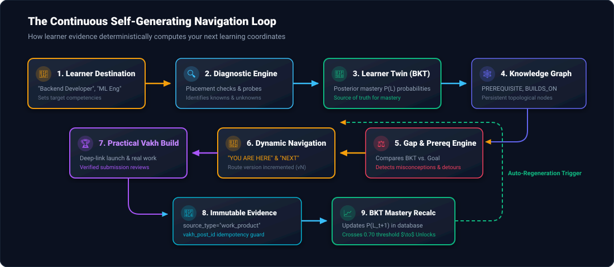
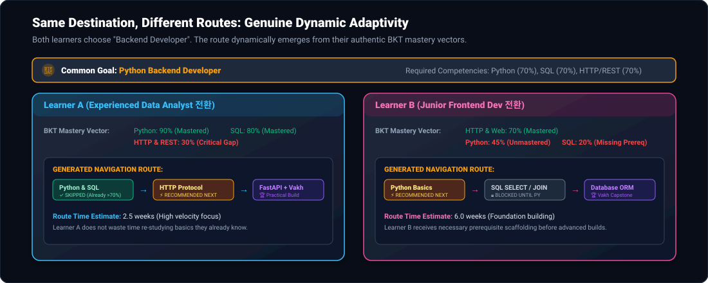
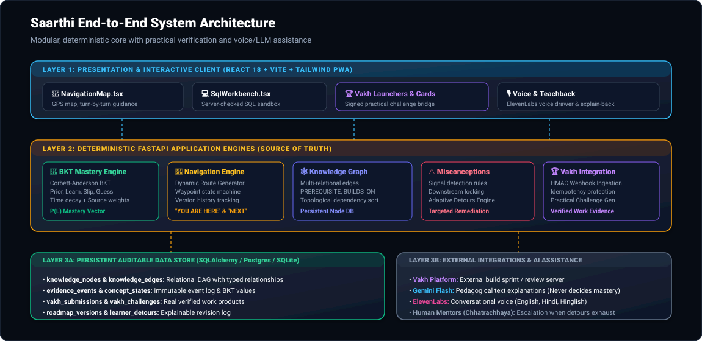

<p align="center">
  
</p>

<p align="center">
  <a href="https://github.com/mrgraciz123/Saarthi_AI"></a>
  
  
  
  
  
  
  
</p>

---

## 🧭 Executive Summary: Google Maps for Learning

Traditional learning roadmaps are static checklists that treat every learner like an identical assembly-line worker. If a student struggles with a prerequisite or arrives with prior knowledge, a static roadmap is blind to it.

**SAARTHI is "Google Maps for Learning."**

Just like GPS navigation dynamically reroutes when there is traffic, construction, or a missed turn:
1. **Destination Selection**: A learner sets a career destination (e.g., *Python Backend Developer*, *Machine Learning Engineer*).
2. **Current Coordinates**: Saarthi evaluates the learner's actual state via diagnostic probes and evidence-backed **Bayesian Knowledge Tracing (BKT)**.
3. **Graph Traversal**: It maps competencies onto a persistent, multi-relational **Knowledge Graph**.
4. **Dynamic Waypoint Generation**: It computes real-time coordinates:
   - **`YOU ARE HERE`**: Current mastered concept.
   - **`RECOMMENDED NEXT`**: The exact next learning action based on mastery gaps and prerequisite readiness.
   - **`BLOCKED UNTIL`**: Downstream concepts locked until foundational prerequisites cross the 70% threshold.
   - **`ADAPTIVE DETOUR`**: Automatic redirection when struggle on an advanced topic stems from a weak prerequisite.
   - **`MISCONCEPTION ALERT`**: Targeted remediation when diagnostic signals detect deep conceptual confusion.
5. **Practical Verification via Vakh**: Integrates **Vakh** as the real-world build sprint and review layer, turning verified work products into evidence that moves the needle on BKT mastery.

---

## 🔄 The Self-Generating Navigation Loop

The core architecture operates as an evidence-driven closed loop:

<p align="center">
  
</p>

```
🎯 GOAL ──▶ 🔍 DIAGNOSTIC ──▶ 🧠 LEARNER TWIN (BKT) ──▶ 🕸️ KNOWLEDGE GRAPH
                                                               │
                                                               ▼
⚡ NEXT ACTION ◀── 🧭 DYNAMIC ROUTE ◀── ⚠️ DETOURS ◀── ⚖️ GAP DETECTION
     │
     ├─── 📖 Interactive Learning Unit (Explanations, Worked Examples)
     ├─── 💻 Server-Verified SQL Sandbox & Code Exercises
     └─── 🏆 Vakh Practical Challenge (Real Build, Submit, Review)
                                                               │
                                                               ▼
                                                     📄 IMMUTABLE EVIDENCE EVENT
                                                               │
                                                               ▼
                                                     📈 BKT POSTERIOR UPDATE
                                                               │
                                                               └──▶ Auto-Regenerates Map (vN)
```

---

## 📍 Waypoint Navigation States in Action

The learner interacts with an interactive GPS-style map interface showing live waypoint states:

<p align="center">
  
</p>

| State | Badge | Description | Trigger Condition |
|---|---|---|---|
| **`MASTERED`** | <kbd>✓ MASTERED</kbd> | Competence confirmed through diagnostic/practical checks | $P(L) \ge 0.70$ and no active misconceptions |
| **`RECOMMENDED NEXT`** | <kbd>⚡ NEXT ACTION</kbd> | Optimal immediate waypoint to study or build | Highest priority unmastered node with satisfied prerequisites |
| **`ADAPTIVE DETOUR`** | <kbd>↻ DETOUR</kbd> | Rerouted to a prerequisite foundation after struggle | Downstream struggle logs indicate weak foundation |
| **`MISCONCEPTION`** | <kbd>⚠️ MISCONCEPTION</kbd> | Needs targeted remediation (e.g. JOIN confusion) | Specific misconception signal confirmed |
| **`BLOCKED`** | <kbd>🔒 BLOCKED UNTIL</kbd> | Downstream topic locked to prevent cognitive overload | Incoming prerequisite $P(L) < 0.70$ |
| **`AVAILABLE`** | <kbd>○ AVAILABLE</kbd> | Prerequisites met, ready to be scheduled | Incoming prerequisites $P(L) \ge 0.70$, $P(L) = 0.0$ |

---

## 👥 Same Goal, Different Journeys: True Adaptivity

A non-adaptive system gives all learners the same sequence. **Saarthi proves genuine adaptivity** by deriving completely different routes for two learners targeting the same goal:

<p align="center">
  
</p>

- **Learner A** (Strong in Python & SQL, weak in HTTP):
  - Python & SQL are marked `MASTERED` $\to$ **Skipped**.
  - Route starts directly at `HTTP Protocol` $\to$ `REST APIs` $\to$ **Vakh Backend Project** (Duration: ~2.5 weeks).
- **Learner B** (Strong in HTTP, beginner in Python & SQL):
  - HTTP is marked `MASTERED` $\to$ **Skipped**.
  - Route builds foundations: `Python Basics` $\to$ `SQL SELECT` $\to$ `JOINs` $\to$ **Vakh Database Project** (Duration: ~6 weeks).

---

## 🏗️ System Architecture

Saarthi strictly separates **deterministic state computation** from **pedagogical AI assistance**:

<p align="center">
  
</p>

### Architecture Principles:
1. **BKT + Graph + Evidence = Source of Truth**:
   Mastery, prerequisites, locking, and route planning are **100% deterministic** and stored in relational database tables.
2. **AI Assistance Strictly Sandboxed**:
   Gemini (`gemini-3.5-flash-lite`) and ElevenLabs Voice **never** set mastery or decide roadmap transitions. They generate explanations, suggest worked examples, or converse with the learner.
3. **Tamper-Proof Evaluation**:
   SQL evaluation is executed in a read-only SQLite server sandbox (SELECT only, timeout, row limits), and Vakh submissions are verified via cryptographic signatures.

---

## 🏆 Real Vakh Integration

Saarthi integrates **Vakh** as the practical build, submission, and review layer:

```
[Saarthi detects skill gap]
          │
          ▼
[Generates Contextual Vakh Challenge] (e.g., Multi-table Course Registration API)
          │
          ▼
[Deep-Link Launcher] ────▶ Learner opens Vakh with signed state payload
          │
          ▼
[Learner Submits Work on Vakh]
          │
          ▼
[Vakh Webhook Notification] ────▶ POST /api/vakh/webhook
          │                        ├── Header: X-Vakh-Signature (HMAC-SHA256)
          │                        └── Idempotency: vakh_post_id uniqueness guard
          ▼
[Immutable EvidenceEvent Created] (source_type = "work_product")
          │
          ▼
[BKT Posterior Mastery Recomputed] ──▶ Auto-Regenerates Map (vN)
```

- **Deep Link Launcher**: `GET /api/vakh/launch/{concept_id}` generates a signed redirect URL to the Vakh challenge portal.
- **HMAC-SHA256 Webhook Verification**: `POST /api/vakh/webhook` validates requests against `VAKH_WEBHOOK_SECRET`.
- **Idempotency Protection**: Enforces database uniqueness on `vakh_post_id` to prevent duplicate submissions from inflating mastery.

---

## 🕸️ Knowledge Graph Data Model

The curriculum is represented as a persistent relational directed graph via SQLAlchemy in [`backend/app/models_ext/G01.py`](backend/app/models_ext/G01.py):

### Node Types (`KnowledgeNode`)
`SKILL` · `CONCEPT` · `TOPIC` · `PROJECT` · `PRACTICE` · `ASSESSMENT` · `RESOURCE` · `CHALLENGE`

### Multi-Relational Edge Types (`KnowledgeEdge`)
`PREREQUISITE` · `BUILDS_ON` · `RELATED_TO` · `PART_OF` · `LEADS_TO` · `ASSESSED_BY` · `PRACTICED_BY` · `VERIFIED_BY`

---

## ⚡ Quick Start & Local Run

### Prerequisites
- **Python 3.12+**
- **Node.js 20+**
- **npm 10+**

### 1. Backend Setup

```powershell
# Navigate to backend directory
cd backend

# Create & activate virtual environment
python -m venv .venv
.\.venv\Scripts\Activate.ps1

# Install dependencies
python -m pip install -r requirements.txt

# Configure environment variables
copy .env.example .env
# Edit .env and set your GEMINI_API_KEY, VAKH_WEBHOOK_SECRET, etc.

# Start FastAPI server
python -m uvicorn app.main:app --port 8000 --reload
```

Backend will be active at <http://127.0.0.1:8000> (Swagger docs at <http://127.0.0.1:8000/docs>).

### 2. Frontend Setup

```powershell
# In a new terminal, navigate to frontend directory
cd frontend

# Install npm dependencies
npm install

# Start Vite development server
npm run dev
```

Open <http://localhost:5173> in your browser. Navigate to the **Roadmap** tab to explore the interactive **Google Maps for Learning** navigation map!

---

## 🧪 Automated Test Suite

Saarthi enforces strict regression testing across all domain engines, BKT updates, adapter contracts, and Vakh flows:

```powershell
cd backend
.\.venv\Scripts\python.exe -m pytest -q
```

**Result: 355 passed** in ~37s.

Key test suites:
- [`backend/tests/test_learning_navigation.py`](backend/tests/test_learning_navigation.py): Covers two-learner route differentiation, prerequisite unlocking, adaptive detours, goal switching with mastery preservation, and Vakh HMAC webhook idempotency.
- [`backend/tests/test_mastery.py`](backend/tests/test_mastery.py): Corbett-Anderson BKT update correctness, time decay, and evidence weighting.
- [`backend/tests/test_adapter_contracts.py`](backend/tests/test_adapter_contracts.py): Contract testing for auth, mentors, consent, and cohorts.
- [`backend/tests/test_sqlcheck.py`](backend/tests/test_sqlcheck.py): Read-only sandbox execution and SQL AST query verification.

Frontend checks:
```powershell
cd frontend
npm run typecheck    # Zero TypeScript errors
npm run build        # Production bundle built in ~6s
```

---

## 📂 Project Structure

```
Saarthi_AI/
├── assets/                          # SVG diagrams & visual architecture
│   ├── saarthi-hero.svg             # Hero branding & coordinates banner
│   ├── navigation-loop.svg          # Closed-loop self-generating navigation
│   ├── gps-waypoint-flow.svg        # GPS waypoint states diagram
│   ├── system-architecture.svg      # Layered architecture diagram
│   └── two-learners-diff.svg        # Dynamic two-learner differentiation
├── backend/
│   ├── app/
│   │   ├── content/                 # Curated concepts, roles, rubrics, questions
│   │   ├── engines/                 # Deterministic Core Engines
│   │   │   ├── mastery.py           # Bayesian Knowledge Tracing (BKT)
│   │   │   ├── knowledge_graph.py   # Multi-relational graph management
│   │   │   ├── learning_navigation.py # "Google Maps for Learning" route generator
│   │   │   ├── challenge_generator.py # Practical challenge generator
│   │   │   ├── vakh_adapter.py      # Real Vakh HMAC bridge & idempotency
│   │   │   ├── misconception.py     # Misconception signal detection
│   │   │   └── planner.py           # Adaptive study scheduler
│   │   ├── models_ext/              # Extensible SQLAlchemy models (G01.py)
│   │   ├── routes/                  # API endpoints (map.py, vakh.py, etc.)
│   │   └── main.py                  # FastAPI application entrypoint
│   └── tests/                       # 355 Pytest unit & integration tests
├── frontend/
│   ├── src/
│   │   ├── components/
│   │   │   ├── NavigationMap.tsx    # Interactive GPS Navigation Map component
│   │   │   ├── SqlWorkbench.tsx     # Server-verified SQL sandbox
│   │   │   └── ExplainBack.tsx      # Teach-it-back review component
│   │   ├── pages/                   # Roadmap.tsx, Learn.tsx, Dashboard.tsx
│   │   └── api.ts                   # Typed API client
│   └── package.json
└── README.md
```

---

## 🔒 Security & Integrity

- **Cryptographic Webhook Verification**: Vakh webhooks require valid HMAC-SHA256 signatures matching `VAKH_WEBHOOK_SECRET`.
- **Server-Side Sandbox**: Learner SQL is executed against isolated SQLite connections with read-only authorizers. No code execution is trusted from the client.
- **Auditable Version History**: Every roadmap mutation generates an immutable `RoadmapVersion` explaining *why* the route changed.
- **Privacy & GDPR Compliance**: Full export (`GET /api/me/export`) and deletion (`DELETE /api/me`) endpoints.

---

## 📄 Documentation

- [Voice Setup Guide (ElevenLabs)](docs/ELEVENLABS_SETUP.md)
- [Mock → Real Adapter Configuration](docs/SWAPPING_MOCK_TO_REAL.md)
- [Demo Walkthrough Script](docs/DEMO.md)
- [Content Review Sheet](docs/CONTENT_REVIEW.md)

---

<p align="center">
  <b>Built with ❤️ by the SAARTHI Team</b><br />
  <i>Adaptive learning powered by mathematics, knowledge graphs, and real-world builds.</i>
</p>
